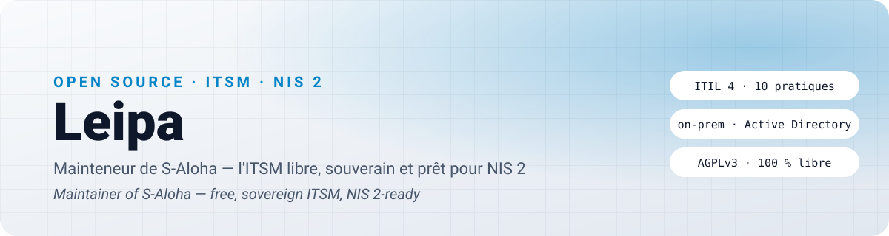

<picture>
  <source media="(prefers-color-scheme: dark)" srcset="assets/banner-dark.svg">
  <source media="(prefers-color-scheme: light)" srcset="assets/banner-light.svg">
  
</picture>

### ⚡ En ce moment · *Right now*

- 🧭 Je fais avancer **S-Aloha** vers sa première version stable : les dernières règles des pratiques ITIL, puis les pièces jointes et les courriels.
  *Shipping S-Aloha towards its first stable release: the last ITIL practice rules, then attachments and email.*
- 🛡️ La conformité **NIS 2** au cœur de l'outil : évaluation sur le référentiel de l'ANSSI, déclarations réglementaires avec leurs échéances.
  *NIS 2 compliance built in: assessment against the ANSSI framework, regulatory notifications with their deadlines.*
- 🏠 Tout tourne **chez vous** : vos données restent dans votre infrastructure, votre annuaire gère les accès.
  *Everything runs on your premises: your data stays in your infrastructure, your directory handles access.*

### 🧩 S-Aloha en un coup d'œil · *At a glance*

| | |
|---|---|
| 🎫 **Service desk** | Incidents, demandes, problèmes, changements · *incidents, requests, problems, changes* |
| 🗺️ **CMDB** | Découverte du réseau, portefeuille applicatif, impact sur les services · *network discovery, application portfolio, service impact* |
| 📈 **Pilotage** | SLA, tableau de bord, console « ce qui vous attend » · *SLAs, dashboards, a console of what needs you now* |
| 📚 **Savoir** | Base de connaissances, amélioration continue, projets · *knowledge base, continual improvement, projects* |
| 🔐 **Conformité** | NIS 2, RGPD, journal d'audit, droits par périmètre · *NIS 2, GDPR, audit trail, scoped permissions* |

### 🧰 Pile · *Stack*

  
  
  
  
  
  
  
  
  

### 🤝 Venir coder · *Join in*

- 🌱 Pour commencer · *first steps* : [`good first issue`](https://github.com/chrraj7/S-Aloha/issues?q=is%3Aissue+is%3Aopen+label%3A%22good+first+issue%22) · [`help wanted`](https://github.com/chrraj7/S-Aloha/issues?q=is%3Aissue+is%3Aopen+label%3A%22help+wanted%22)
- 💬 Idées et questions · *ideas and questions* : [Discussions](https://github.com/chrraj7/S-Aloha/discussions)
- 🔒 Faille de sécurité · *security issue* : [signalement privé](https://github.com/chrraj7/S-Aloha/security/advisories/new)
- 💛 Soutenir · *support* : [GitHub Sponsors](https://github.com/sponsors/chrraj7) · [comment ça marche](https://github.com/chrraj7/S-Aloha/blob/main/docs/soutenir.md) — *S-Aloha stays free: no paid edition, no locked feature.*

Libre, souverain, sans pistage · <i>Free, sovereign, no tracking</i>

